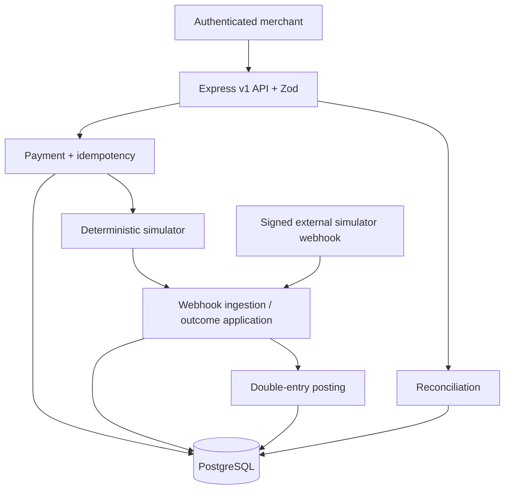

# Architecture

LedgerFlow is a **modular monolith**. Express handles HTTP and validation; payment, webhook, ledger, and reconciliation modules own domain behavior; Prisma holds transactional boundaries. No external queues or live payment providers are used.



## Boundaries

- `config/env.ts`: validates runtime configuration; never exports secrets to routes.
- `app.ts`: middleware ordering, correlation IDs, security headers, rate limiting, Swagger, versioned routing.
- `middleware/auth.ts`: hashes bearer secrets and resolves merchant identity. Routes must scope all merchant-owned lookups with it.
- `payments`: Zod inputs, state transition rules, idempotent creation, conditional cancellation and serialization.
- `idempotency`: stable canonical JSON SHA-256 fingerprint; transaction-scoped PostgreSQL advisory key lock and unique constraint in `payments/service.ts`.
- `providers/provider.ts`: provider adapter contract; `providers/simulator.ts`: one persistent provider operation per payment, synthetic outcome, non-resubmitting verification.
- `webhooks`: exact-byte HMAC, durable receipt and duplicate check, transaction-locked payment state and ledger posting.
- `ledger`: two balanced entries in a single transaction; DB triggers forbid updating or deleting posted entries.
- `reconciliation`: CSV parser, deterministic exact-ID classification, durable runs and auditable resolution notes.
- `infrastructure/database`: Prisma client lifecycle.

## Create payment sequence

```mermaid
sequenceDiagram
  participant C as Merchant
  participant API as API
  participant PG as PostgreSQL
  participant SIM as Simulator
  participant WH as Outcome handler
  C->>API: POST /payments + Idempotency-Key
  API->>PG: Begin; advisory lock; find/create payment and key
  PG-->>API: Commit stable payment ID
  API->>SIM: Start only when newly created and not held
  SIM->>PG: Atomically mark PROCESSING + reserve unique provider operation
  opt Determinate terminal simulator result
    SIM->>WH: Persist and process synthetic event
    WH->>PG: Lock payment, transition, post ledger in one transaction
  end
  API-->>C: Payment representation with stable ID
```

### Key invariants and boundaries

Payment records are scoped to the authenticated merchant. Provider operations are one-to-one with payments. All outward-facing amounts use decimal strings. Terminal payment states cannot transition again. A provider event must match its registered provider transaction ID, and ledger posting and status change commit atomically. Reconciliation is descriptive; it cannot change payments or ledger postings.

**Failure behavior:** If the server fails after the idempotency and payment transaction commits but before simulator submission, the payment remains `PENDING`. Replays return its existing ID but do not initiate a second operation. Such records need operator investigation; a production solution would have a durable dispatch/outbox and controlled recovery. If the provider reservation commits but an outcome handler fails, the provider state is retained, the failure is marked, and `verify` can consume a known terminal outcome without reissuing an operation. A transaction rollback cannot leave an incomplete posting.

**Trade-offs:** The first terminal signed provider event to commit wins; reconciliation surfaces later disagreements, rather than trusting a late event to overwrite a completed payment. App-level security and PostgreSQL unique constraints provide the core guarantee. The system deliberately omits distributed infrastructure, background workers, and settlement orchestration.

## Interview review

**Why not microservices?** Atomic payment/ledger transactions are a strength of one PostgreSQL-backed process; a split would require distributed workflow coordination and compensations.

**What changes at scale?** Use a durable dispatch outbox and webhook inbox worker, tenant-scoped quotas, shared rate limiting, tracing and metrics, more restricted database privileges, and automated incident handling. Do not claim these are implemented.
