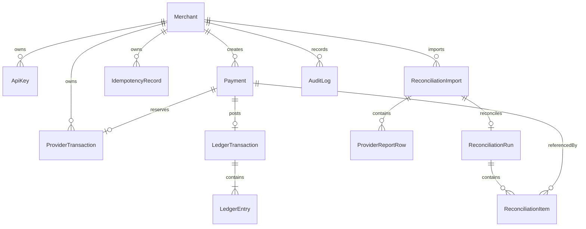

# Data model and database invariants

Source of truth: `prisma/schema.prisma` and `prisma/migrations/20261029000000_init/migration.sql`. PostgreSQL 16 in Docker Compose.

| Entity                 | Purpose / significant constraint                                                                                                                                                                    |
| ---------------------- | --------------------------------------------------------------------------------------------------------------------------------------------------------------------------------------------------- |
| `Merchant`             | Globally unique slug, root tenant identity.                                                                                                                                                         |
| `ApiKey`               | SHA-256 hash unique, merchant FK, optional revocation timestamp. No plaintext secret persisted.                                                                                                     |
| `Payment`              | Merchant FK, amount `BIGINT` positive and ≤10^12, currency whitelist, state enum, created and updated timestamps, index `(merchantId,createdAt,id)`.                                                |
| `ProviderTransaction`  | Globally unique `(provider,externalId)` and unique `paymentId`, persisted outcome.                                                                                                                  |
| `IdempotencyRecord`    | Unique `(merchantId,operation,key)`, fingerprint and payment FK; transaction lock serializes concurrent identical requests.                                                                         |
| `WebhookEvent`         | Globally unique `(provider,eventId)`, receipt, attempts, status and sanitized failure text. It deliberately lacks a payment FK so malformed reference attempts can be durably recorded as failures. |
| `LedgerTransaction`    | Unique `paymentId`, unique posting key, currency, merchant FK; update/delete blocked with database triggers.                                                                                        |
| `LedgerEntry`          | Transaction FK, positive amount check, account whitelist and side enum; update/delete blocked with triggers.                                                                                        |
| `ReconciliationImport` | Merchant FK, filename, provider and timestamp.                                                                                                                                                      |
| `ProviderReportRow`    | Import FK, unique `(importId,lineNumber)`, amount and currency checks, index `(importId,externalId)`; duplicate external IDs remain present for classification.                                     |
| `ReconciliationRun`    | Unique `(merchantId,importId)` to prevent running the same import twice.                                                                                                                            |
| `ReconciliationItem`   | Optional payment/report row FKs, discrepancy enum, resolution text/timestamp, index `(runId,status)`.                                                                                               |
| `AuditLog`             | Merchant FK, timestamp, action, safe JSON details for cancellation and reconciliation actions.                                                                                                      |

## Money and cross-row integrity

**All amounts are integer minor units**, never IEEE floating point. `BIGINT` stores 64-bit integers; API input limited to positive integers ≤1,000,000,000,000, well within safe range. API responses stringify them to avoid JavaScript JSON precision loss. Supported currencies are KES (2 decimals), USD (2), JPY (0), KWD (3); no conversions, FX rates, or implicit decimal parsing. Database constraints independently enforce amount and currency validity on payment and report rows. Ledger entry database checks enforce positive amounts, but cross-row balancing is enforced by the posting service plus an atomic transaction, **not** by a database aggregate constraint.

## Integrity limitations

Several tenant link fields are checked consistently in services but are not all backed by composite merchant-and-resource foreign keys. A database-privileged actor bypassing the app could insert a cross-tenant link. Production should use restrictive DB roles and composite tenant FKs or row-level security. The schema is intended for a trusted single service account, not arbitrary direct SQL writers. Database immutability triggers prevent update/delete of posted ledger rows but permit privileged insertions; the service is the trusted posting path.
