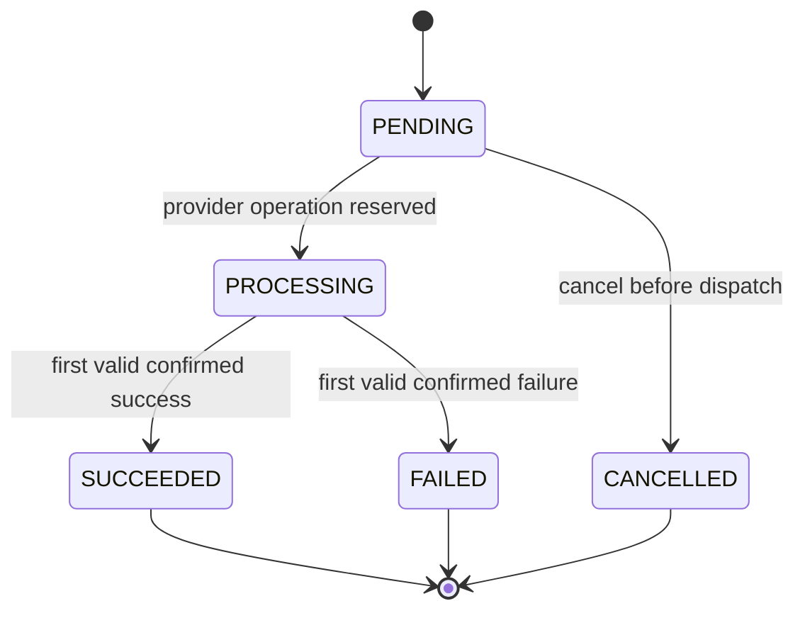

# Payment lifecycle

Implemented in `src/modules/payments/state.ts`, `payments/service.ts`, `providers/simulator.ts`, and `webhooks/service.ts`.

`SUCCEEDED`, `FAILED`, `CANCELLED` are terminal and cannot be changed through the API or webhook event handler. `PENDING` does not mean the provider received a request. `PROCESSING` covers accepted, delayed, timed-out, or unknown external outcomes.

| Event | Behavior |
| --- | --- |
| Create | Insert `PENDING` with idempotency record atomically; new payments advance to `PROCESSING` on provider reservation (except `hold`). |
| Success | Valid signed event on `PROCESSING` -> `SUCCEEDED`; post two ledger entries atomically. |
| Definitive failure | Valid signed event -> `FAILED`; no successful-payment ledger posting. |
| Cancellation | Allowed only when `PENDING` (`hold` demo); `PROCESSING` cancellation returns HTTP 409 to avoid an unsafe reversal. |
| Provider timeout | Operation reserved with `UNKNOWN`; keep `PROCESSING`, no automatic resubmission. |
| Accepted but ambiguous | Operation reserved with `ACCEPTED`; keep `PROCESSING`, even on verify. Signed event can resolve. |
| Duplicate event | Unique `(provider,eventId)`, locked processing, repeat delivery has no new financial effect. |
| Stale/out-of-order terminal outcome | If payment already terminal, mark event `IGNORED` and do not rewrite ledger. |
| Client retry | Merchant+operation+key always identifies the same payment; never creates another provider operation. |
| Unexpected provider or DB failure | Surface error, preserve prior durable writes, never pretend a payment failed if outcome unknown. |

A `ProviderTransaction` is unique by `paymentId`; submission uses a database reservation before outcome processing. `verify` consults only durable provider status; it never resubmits. A crash between initial payment commit and provider reservation can leave a `PENDING` payment requiring operator repair, as no durable dispatch worker is implemented.

**Concurrency:** Conditional `updateMany` protects cancellation, row locks on payment and event serialize outcome handling, ledger `postingKey` and `paymentId` uniqueness prevent duplicate postings. Lock and transaction behavior is covered by authored PostgreSQL integration tests, but these were not executable in the authoring environment.

**Interview question:** Could a timeout be interpreted as `FAILED`? No; the provider may have accepted the transaction. A retry without checking durable identity can double charge. LedgerFlow keeps the outcome uncertain and uses signed events or known provider state to resolve it.
